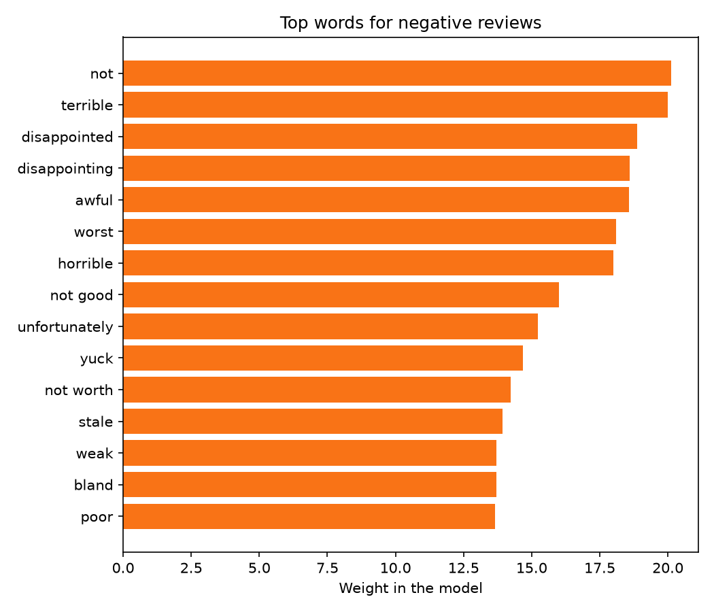
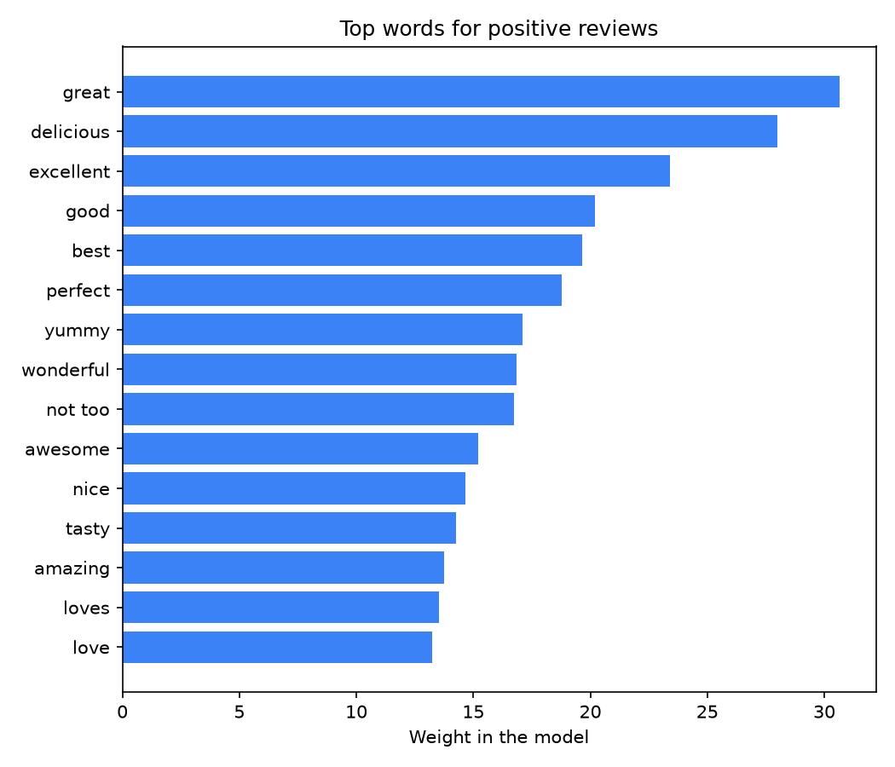

# Amazon Review Sentiment Analysis

https://amazon-sentiment-bput.streamlit.app/

Binary sentiment classification of Amazon Fine Food Reviews with TF-IDF and linear models, a leak-free evaluation, an error analysis and a Streamlit dashboard.

Dataset: [Amazon Fine Food Reviews](https://www.kaggle.com/datasets/snap/amazon-fine-food-reviews) (Kaggle). The CSV is not included.

## Task setup

- Label from stars: 4-5 = positive, 1-2 = negative. 3-star reviews are dropped.
- Negative is the target class (15.6% of reviews), so precision, recall, F1 and PR-AUC are reported instead of accuracy.
- 30.8% of review texts were duplicates and were removed (364,910 reviews left).
- The split is made by user, so no author appears in both train and test.

## Results (test set, negative class)

| Model | Threshold | Precision | Recall | F1 | PR-AUC |
|---|---|---|---|---|---|
| Always positive | - | 0.000 | 0.000 | 0.000 | 0.156 |
| Logistic regression | 0.50 | 0.759 | 0.934 | 0.837 | 0.930 |
| Logistic regression | 0.36 | 0.854 | 0.880 | 0.867 | 0.936 |
| Linear SVM | 0.38 | 0.865 | 0.890 | 0.877 | 0.943 |
| Complement NB | 0.62 | 0.785 | 0.859 | 0.820 | 0.882 |

Thresholds were chosen on a validation part of the training set, never on the test set. The gap between SVM and logistic regression is small.

## What the model learned

Negative words: terrible, disappointed, awful, worst, stale, bland, not good. Positive words: great, delicious, excellent, perfect, yummy.





## Errors: noisy labels

Many mistakes are label noise. Some reviews say "so delicious" but have 1-2 stars, and some say "disgusting" but have 4-5 stars. The model is very confident on these, so true quality is probably higher than the metrics show.

## Dashboard

```bash
streamlit run app.py
```

## Installation

```bash
git clone https://github.com/om-mmdv/amazon-sentiment.git
cd amazon-sentiment
python -m venv venv
venv\Scripts\activate
pip install -r requirements.txt
```

Put Reviews.csv into data/, then run: python -m src.explore, baseline, analyze, compare, export_model.

## Limitations

- Bag-of-words cannot handle sarcasm or mixed reviews well.
- Labels come from noisy star ratings.
- Food reviews only, English only.

## Possible improvements

- Fine-tune DistilBERT and compare with TF-IDF
- Predict the 1-5 star rating
- Flag reviews where text and stars disagree
